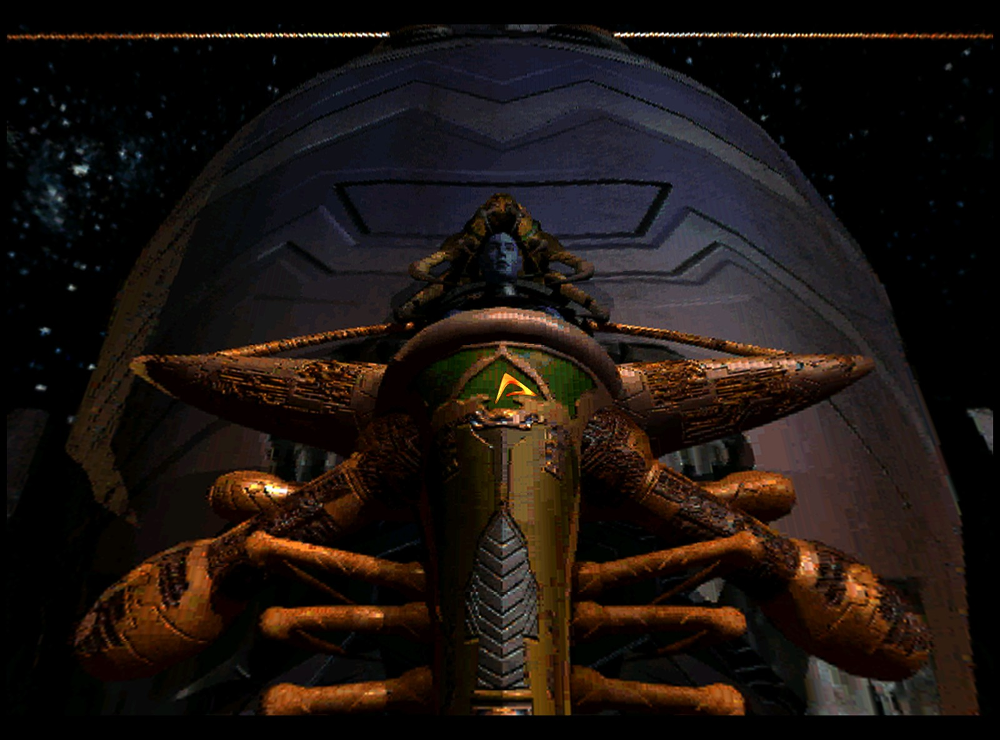
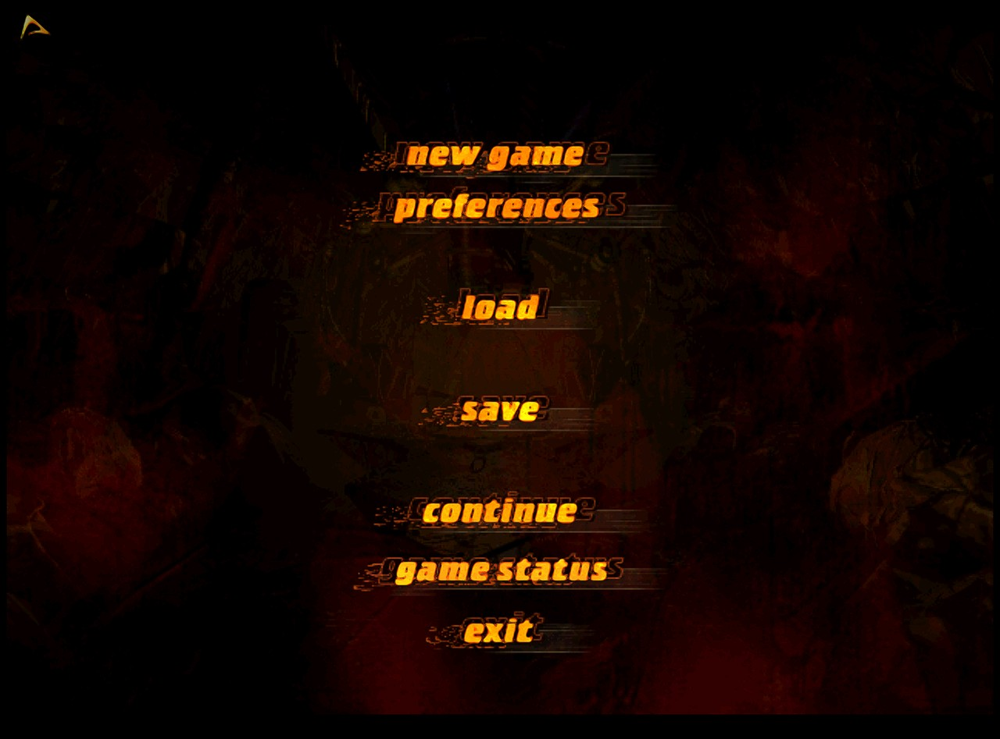
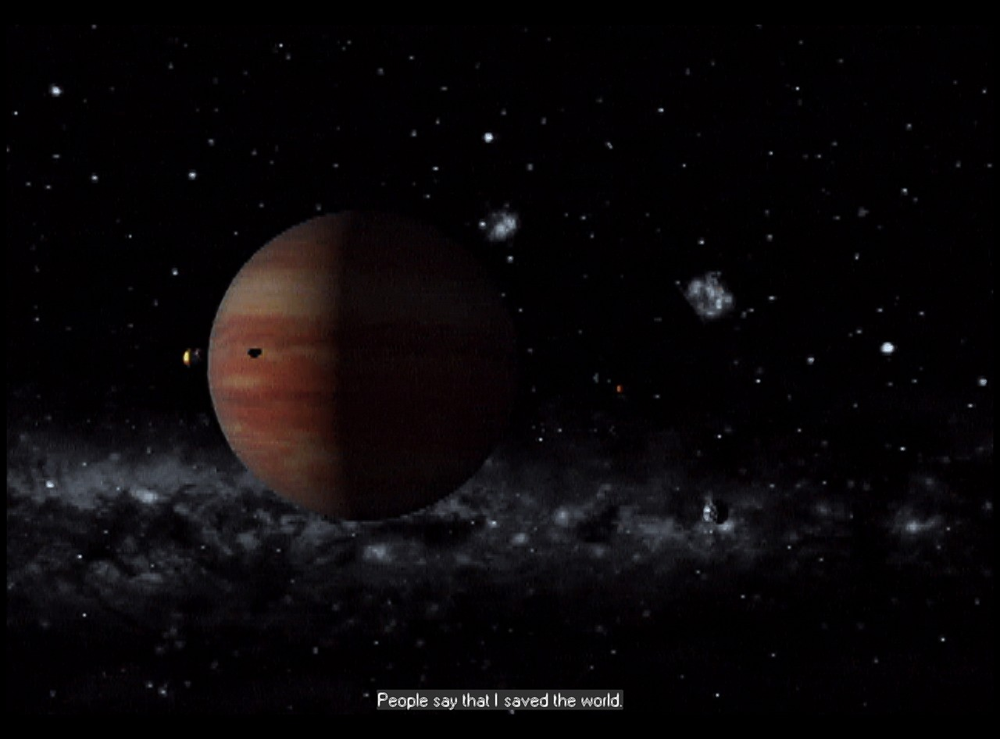
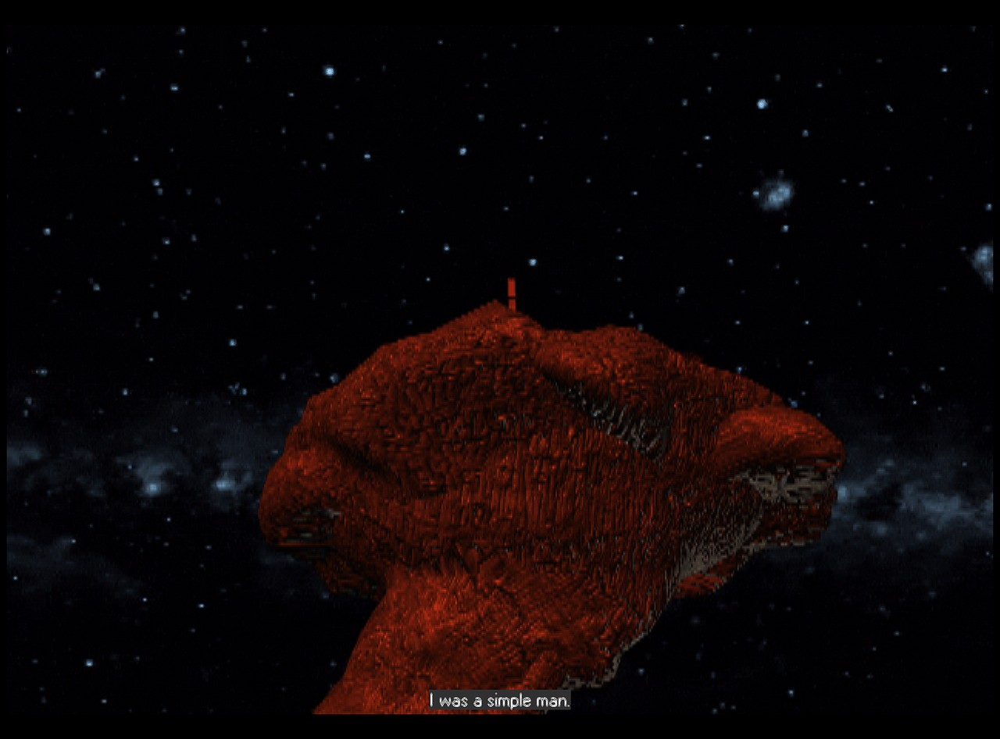
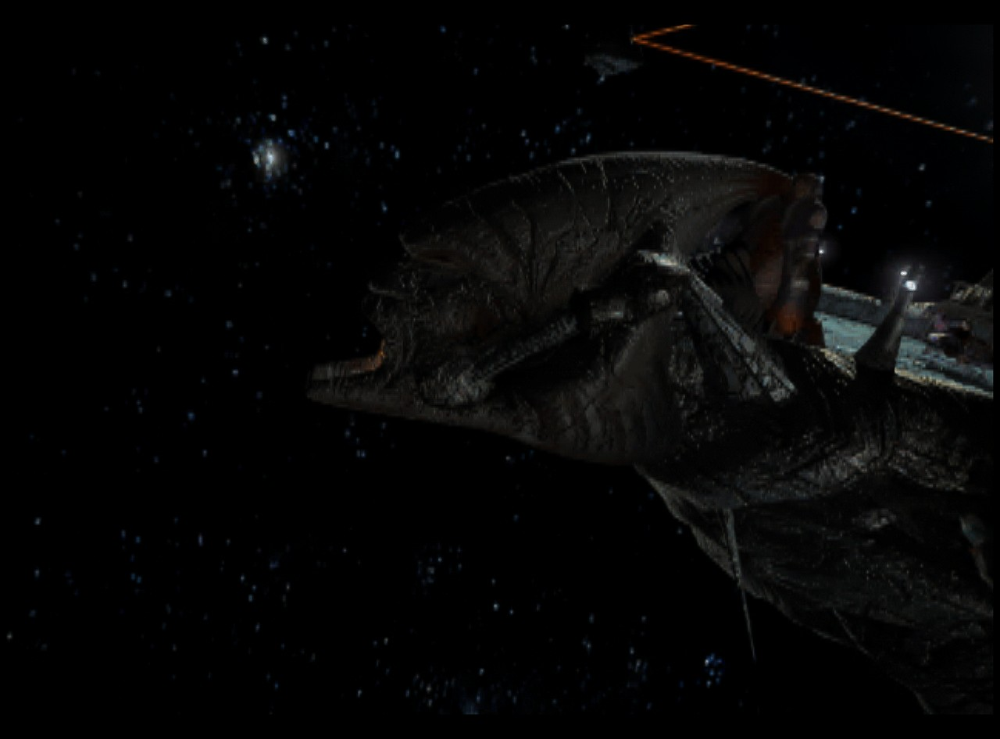
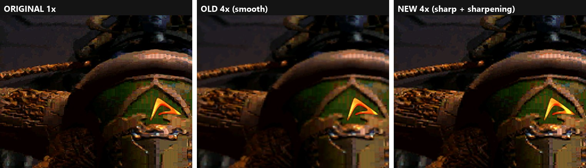
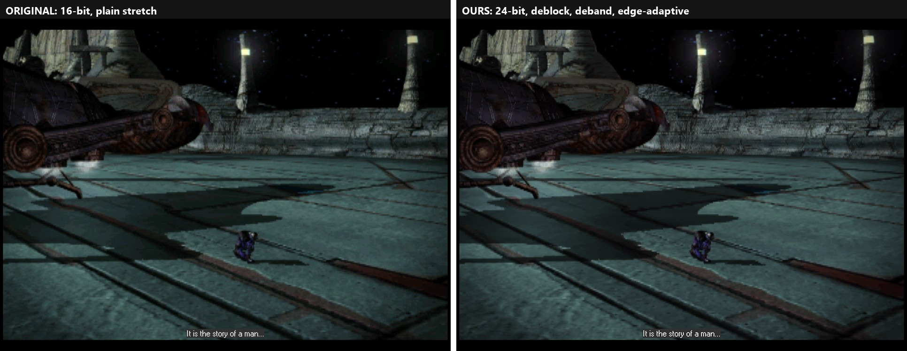
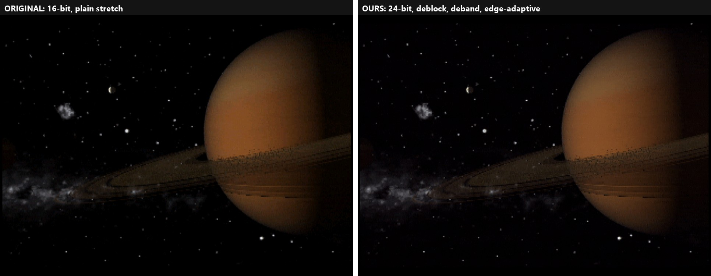

# Ring: The Legend of the Nibelungen – PC Native

A native port of *Ring: The Legend of the Nibelungen* (Arxel Tribe / Cryo, 1999) for modern Windows.
The game's own code (`ring.exe`, MSVC) is converted from x86 machine code to C by a static recompiler and
runs on a new runtime that replaces Windows 95, DirectDraw and DirectSound with code written for today's PCs.
It doesn't use compatibility layers, wrappers or an emulator.

**This repository contains no game files.** You need your own copy of the game (the 4-CD version).



## Screenshots

| | |
|---|---|
|  |  |
| Main menu | Intro movie in full colour |
|  |  |
| Intro movie | Intro movie |

### Internal resolution: the 360-degree views are drawn again at up to 4x



The game's panoramas are stored as large compressed pictures that the original warps onto a 640x480
screen. The port draws that warp again at up to 4x (2560x1920) straight from the stored picture, with
sharp filtering, at 60 fps. Left to right: the original, plain 4x, 4x with sharp filtering (the default).

### Movies in full colour




The game decodes its movies in 24-bit colour and then cuts them down to 16-bit for the screen. The port
shows the full-colour frame, smooths the compression blocks and colour banding, and scales it up with an
edge-adaptive filter.

## What's new compared to the original

- **Real higher resolution for the 360-degree views** – Video > Internal Resolution (panoramas): 1x–4x
  (4x default), drawn again by the game's own warp, not just scaled up.
- **Movies in full colour** – 24-bit instead of the game's 16-bit, with optional deblocking and debanding
  (Video menu, on by default).
- **No disc swapping** – the setup copies all four CDs into one folder; the game never asks for a disc.
- **Presentation** – upscale filters (edge-adaptive FSR-style, bicubic, nearest, bilinear, sharp bilinear,
  xBR), contrast-adaptive sharpening, FXAA, 4:3 / stretch / integer scaling, any window size,
  Alt+Enter fullscreen.

## Installing

1. Download **`Ring PC Setup.exe`** from [Releases](../../releases).
2. Run it and point it at your four game CDs: the discs, images (`.iso`, `.bin`/`.cue`) or folders with a
   copy of each disc. Images next to the setup and discs in the drives are found by themselves. Choose a
   folder and press Install.
3. Start the game from the Start menu or desktop shortcut.

The setup copies all four CDs (about 2.6 GB) and lays out the hard-disk files the way the original
installer did. Nothing is downloaded. An uninstaller is included (Apps & features).

**Options** (menu bar of the game window, or `ring.ini` next to the exe): Internal Resolution
(panoramas) 1x–4x, Resolution, Aspect Ratio, Upscale Filter, Sharpening, FXAA, Movies in full colour,
Movie deblocking / debanding, Window Size, Fullscreen.

## Status

Work in progress (v0.1). Tested so far: intro, main menu, New Game, the opening cutscenes, the first
360-degree view, installing and uninstalling.
Not tested yet: saving and loading, the later chapters, the whole story.

## Building

Windows Python 3 with capstone + Pillow, MSYS2 MINGW64 (gcc, SDL2), Ghidra only to remake the function list.

1. Put the game's `ring.exe` (CD 1) in `gamedata/ring.exe`.
2. Make the play folders from copies of the four CDs: `python tools/mkgame.py <folder with disc1..disc4>`
   (`game/hd/` = the installed game folder, `game/cd/` = all four CDs merged).

```bash
make gen                     # recompile ring.exe -> src/gen/ (uses re/ring/functions.tsv)
make -j8                     # build Ring.exe
make release                 # build/setup.exe with the game exe inside -> "Ring PC Setup.exe"
./run_test.sh 30             # hidden, muted test run
```

Test switches: `RING_SHOT=ms;ms`, `RING_SHOTOUT=1`, `RING_KEYS=ms:vk[:hold];…`, `RING_CLICK=x,y,ms;…`,
`RING_RENDER=n`, `RING_WINSIZE=WxH`, `RING_RECORD=file.mp4` (+ `_FROM`, `_MS`).

## Layout

| Path | What |
|---|---|
| `src/rt/` | the runtime: Win32 (kernel/user/GDI), guest threads as fibers, virtual memory |
| `src/rt/ddraw.c`, `dsound.c`, `win16.c` | DirectDraw (16-bit), DirectSound (SDL), 16-bit file and mmio calls |
| `src/rt/hires_pano.c` | the N x render of the 360-degree views |
| `src/rt/movie_hq.c` | full-colour movies, deblocking, debanding |
| `src/rt/ring_game.c` | game hooks (one folder holds all four discs) |
| `src/rt/present.c` | Direct3D 9 presenter, filters, Video menu, settings |
| `tools/recomp.py`, `tools/x86an.py`, `tools/pe.py` | x86 -> C recompiler, code analysis, PE loader |
| `tools/native_ring.txt` | game functions wrapped by native C |
| `re/ring/functions.tsv` | Ghidra's function list of `ring.exe` |
| `installer/` | the setup: all four CDs, the original install list, uninstaller |

Fan preservation project, not affiliated with Arxel Tribe, Cryo Interactive, DreamCatcher or the game's
other publishers. All trademarks belong to their owners.
